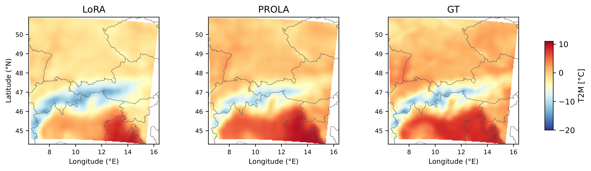
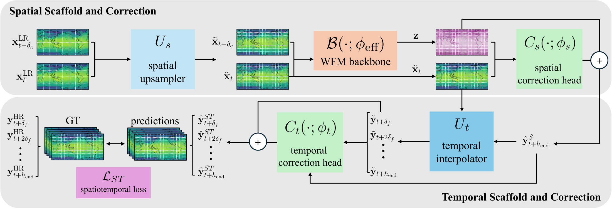
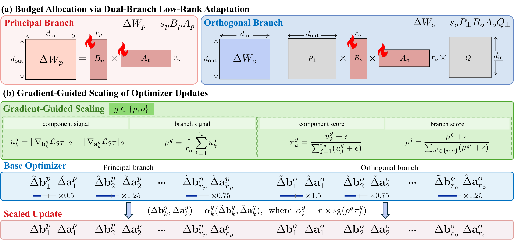

<h1 align="center">🌦️ PROLA</h1>
<h3 align="center">Principal-Orthogonal Low-rank Adaptation<br>for Predictive Spatiotemporal Weather Downscaling</h3>

<p align="center">
  <a href="#citation"></a>
  <a href="#getting-started"></a>
  <a href="LICENSE"></a>
</p>

<p align="center">
  <b>Minseo Yoon · Minseong Bae · Sojin Lee · Hyunwoo J. Kim</b><br>
  KAIST
</p>

<p align="center">
  <a href="#overview">Overview</a> ·
  <a href="#results">Results</a> ·
  <a href="#getting-started">Getting started</a> ·
  <a href="docs/data.md">Data</a> ·
  <a href="#citation">Citation</a>
</p>

<p align="center">
  
  <br>
  <em>Fine-scale temperature structure, six hours ahead. LoRA, PROLA, and the CERRA target.</em>
</p>

> **TL;DR** — We introduce **PSWD** to predict high-resolution weather from coarse inputs, and **PROLA** to adapt pretrained weather models with complementary **principal and orthogonal** low-rank branches. PROLA improves on the evaluated low-rank baselines with just **3.92M trainable parameters** in our main setting.

---

<a id="overview"></a>

## 🌍 Overview

Coarse weather states capture broad atmospheric patterns. **Predictive Spatiotemporal Weather Downscaling (PSWD)** asks the model to recover finer spatial detail while predicting its evolution at higher temporal resolution.

We approach this with a **scaffold-and-correct pipeline**: a shared pretrained weather backbone builds the forecast, and lightweight spatial and temporal heads learn the corrections.

<p align="center">
  
</p>

**PROLA adapts the backbone through three ingredients:**

- **Principal branch** — starts from the pretrained weight's leading singular directions.
- **Orthogonal branch** — learns complementary corrections outside those selected subspaces.
- **Gradient-guided updates** — scales optimizer updates across branches and rank components.

<details>
<summary><b>🔍 A closer look at PROLA</b></summary>

<p align="center">
  
</p>

</details>

The repository includes three weather tasks:

| 🌐 Global PSWD | 🗺️ ERA5-to-CERRA | 🌧️ Regional precipitation |
| :---: | :---: | :---: |
| Hourly high-resolution forecasts from coarse global states | Regional weather downscaling from ERA5 to CERRA | Forecasting regional rainfall accumulations |

<a id="results"></a>

## 📊 Main results

PROLA achieves the lowest RMSE among the evaluated low-rank methods across all five variables at both 3h and 6h. Below are the paper's **3h latitude-weighted RMSE ↓**, averaged over three seeds.

| Method | Z500 | T850 | T2M | U10 | V10 |
| --- | ---: | ---: | ---: | ---: | ---: |
| LoRA | 54.72 | 0.898 | 1.199 | 1.219 | 1.181 |
| DoRA | 54.32 | 0.893 | 1.191 | 1.209 | 1.173 |
| AdaLoRA | 53.40 | 0.884 | 1.176 | 1.175 | 1.158 |
| PiSSA | 54.55 | 0.893 | 1.198 | 1.215 | 1.175 |
| OPLoRA | 54.94 | 0.899 | 1.204 | 1.223 | 1.185 |
| **PROLA** | **50.58** | **0.864** | **1.129** | **1.143** | **1.120** |

---

<a id="getting-started"></a>

## 🚀 Getting started

Start with the CPU example, then try the weather pipeline or train on your own prepared data. Tested with Python 3.10 and PyTorch 2.5.1.

<details open>
<summary><b>⚡ Try PROLA on CPU</b></summary>

From the repository root:

```bash
pip install -e .
python examples/minimal_prola.py
```

A self-contained example of PROLA adaptation on a small model.

</details>

<details>
<summary><b>🌦️ Try the weather pipeline</b></summary>

Run training and evaluation with synthetic data and a small randomly initialized backbone:

```bash
pip install -e '.[weather]'
python -m prola.train --config configs/pswd.yaml \
  --smoke-test --device cpu --output-dir runs/pswd_demo
python -m prola.evaluate --run-dir runs/pswd_demo --device cpu
```

</details>

<details>
<summary><b>🛰️ Training and evaluation</b></summary>

Prepare the [data](docs/data.md) and the `aurora-0.25-pretrained.ckpt` weights from [Aurora](https://github.com/microsoft/aurora), then run:

```bash
pip install -e '.[weather]'
python -m prola.train --config configs/pswd.yaml \
  --data-root data/pswd \
  --backbone-checkpoint checkpoints/aurora-0.25-pretrained.ckpt \
  --output-dir runs/pswd

python -m prola.evaluate --run-dir runs/pswd \
  --data-root data/pswd --split test
```

For the regional tasks, use [`cerra.yaml`](configs/cerra.yaml) or [`precipitation.yaml`](configs/precipitation.yaml) with the corresponding data and output directories.

</details>

## 🗂️ Code

- [Adapters](src/prola/adapters/) · [Models](src/prola/models/) · [Tasks](src/prola/tasks/) · [Data](src/prola/data/) · [Metrics](src/prola/metrics/)
- [Training](src/prola/train.py) · [Evaluation](src/prola/evaluate.py)
- [Configs](configs/) · [Examples](examples/) · [Tests](tests/)

<a id="citation"></a>

## 📝 Citation

If you find PROLA useful in your research, please cite:

```bibtex
@inproceedings{yoon2026prola,
  title={{PROLA}: Principal-Orthogonal Low-rank Adaptation for Predictive Spatiotemporal Weather Downscaling},
  author={Yoon, Minseo and Bae, Minseong and Lee, Sojin and Kim, Hyunwoo J.},
  booktitle={Advances in Neural Information Processing Systems},
  year={2026}
}
```

## 🤝 Acknowledgments

We thank the [Aurora](https://github.com/microsoft/aurora) team for sharing their model and implementation. See [LICENSE](LICENSE) and [third-party notices](THIRD_PARTY_NOTICES).
